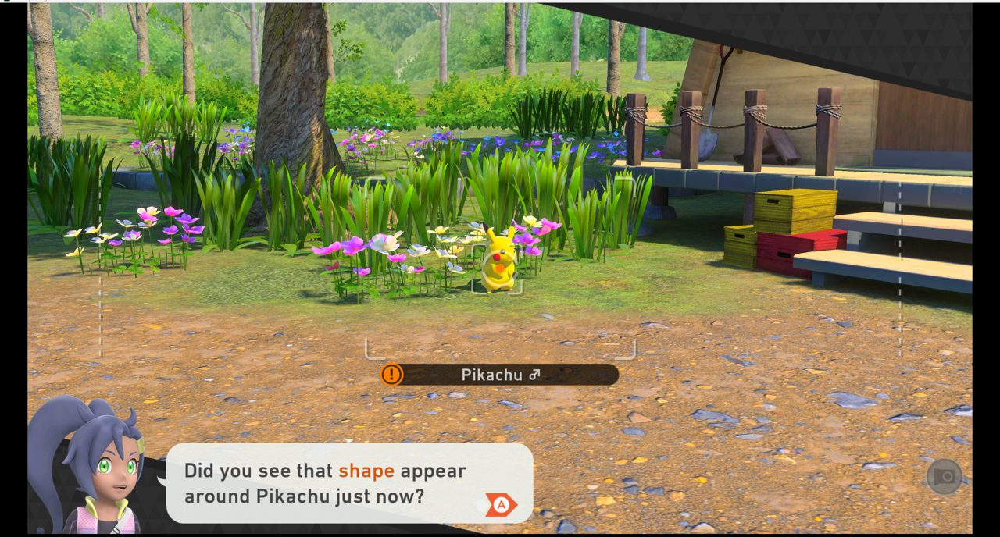

# NewSnapRecomp

A native Windows x64 recompilation of **New Pokémon Snap** (update 2.0.1), built on the
infrastructure of [Astral Chain Recomp](https://github.com/captainj-sparrow/astral-chain-pc-recomp),
which builds on [TotK Recomp](https://github.com/valentderah/totk-pc-recomp). You need your own
legally dumped game and update; nothing from the game is distributed here.

| | |
|---|---|
|  |  |
|  |  |

*Screenshots from an RX 6900 XT: internal resolution 175 %, 200 % (4K inside) and "match display" at 1440p.*

## Status: [0.8.2-tester](https://github.com/MatyMeatBoy/NewSnapRecomp/releases) (prerelease)

Playable through the tutorial, expeditions, photo evaluation and saving on the owner's
RX 6900 XT, with NVIDIA RTX 4060 runs for earlier builds. Still a tester build: not every
course, GPU or controller has been verified.

- **Internal resolution 125–300 % and "match display"**, rendered on the host like emulators
  do: scene, HUD, effects, photos and thumbnails all correct ([SUPERSAMPLING.md](docs/SUPERSAMPLING.md)).
- **30 / 60 / 90 / 120 / 144 FPS** without touching game logic ([HIGH_FPS.md](docs/HIGH_FPS.md)).
- **AMD FSR 3.1 / FSR 4 and NVIDIA DLSS** upscaling or Native AA, and optional
  **FSR frame generation** that pauses itself when the monitor cannot show it.
- **Sun shadow resolution** 1×/2×/4×, anisotropic filtering, colour presets.
- AMD RDNA 1/2 fixes (photo bands, NaN shader math, GPU faults), gyro aiming with adjustable
  sensitivity, controller support through SDL3.
- Launcher with automatic update and local runtime rebuild ([UPDATING.md](docs/UPDATING.md)).

Work queue and how to contribute: [docs/PENDIENTES.md](docs/PENDIENTES.md) (read first) and
[AGENTS.md](AGENTS.md). Older bug reports and release notes in `docs/bugs` and
`docs/releases` are kept as written (many in Spanish).

## Local import

Requires Python 3.12 and your own game files and console keys. None are included.

```powershell
git submodule update --init
py -3.12 -m venv .venv
.venv\Scripts\python -m pip install -r requirements.txt
.venv\Scripts\python -m newsnap import --base "path\base.nsp" --update "path\update.nsp" --keys "path\prod.keys" --hactool "path\hactool.exe"
```

The launcher does the same from Home → "Importar NSP/XCI/NSZ…". `--base` may be NSP, NSZ, XCI or XCZ and `--update` NSP or NSZ; compressed and cartridge dumps are rebuilt as a temporary NSP first (`newsnap/container.py`). Build hactool with `tools/build_hactool.py`. `--exefs-only` imports code modules without merging RomFS. Outputs go to `build/extracted`, with verified hashes and receipts; a second run validates input and output hashes before reuse. A stale output is refused; use another `--work` directory to preserve the earlier import.

```powershell
.venv\Scripts\python -m unittest discover -s tests -v
```

## Experimental build

This development source requires the **pinned fourteen-patch NativeAOT translator**;
the unmodified donor setup and published 0.6 build kit contain the older translator
and are intentionally rejected before generation. A matching new public kit has
not been published yet. Maintainers currently use a separately staged SDK whose
`ac_xlate.exe` and `.id` match `profiles/translator-windows.json`; the original SDK
and released 0.6 assets remain unchanged. See [translator provenance and
verification](docs/bugs/xlate-semantics.md). A manually changed `.id` cannot make an
old executable compatible.

The verified SDK's `llvm/`, `runtime/deps/` and `bin/` directories supply the
compiler, headers, libraries and translator. Install `glslc` and `spirv-val` for
the host-side FSR shader build, then run:

```powershell
.venv\Scripts\python -m newsnap build --sdk-root "path\verified-sdk" --shader-tools "path\shader-tools" --jobs 8
build\updated\newsnap.exe --selftest
build\updated\newsnap.exe --probe-loader
build\updated\newsnap.exe --boot
```

The executable and all game-derived C stay local. The build verifies the imported modules, RomFS and index before compiling. `--no-generate` is allowed only when a receipt binds every generated source to the current modules and generator. Control metadata is rederived from the verified NACP; editing a cached JSON cannot inject compiler definitions.

The current bring-up exposes an offline network interface; online socket/TLS services report unavailable. Native game timing is retained: none of Astral Chain's instruction or FPS patches are applied.

## Local launcher

Windows alpha packages include `NewSnapLauncher.exe`, its dependencies and the
original camera icon. Extract the whole Windows release and place your own
`GameData` (or `newsnapGameData`) folder beside that executable. Python installation
is not required. The owner-data folder contains the imported assets, locally
generated native executable, shader inputs and profile; it is never a GitHub
asset. Keep its runtime compatible with the selected release. See
[0.3 alpha notes](docs/releases/0.3-alpha.md) for controls and tested limits.

From a development checkout:

```powershell
.venv\Scripts\python -m newsnap launcher
```

The Spanish launcher provides profile selection, shader preparation, video and
input settings, and a read-only photo album with export. Settings apply on the
next game launch. Unrelated INI settings and changes made through the runtime
menu are preserved. Window size, native docked/handheld output, internal render
scale and final presentation scaling are separate controls; see
[video compatibility](docs/VIDEO_COMPATIBILITY.md) for their limits.

The album reads explicit exports from the profile's `photos` directory and
committed photo containers in that profile's save. Refresh is deferred while an
expedition holds the launcher profile lock. It excludes transaction
folders and diagnostic screenshots. Parsing was tested with synthetic photos
and real saved tutorial photographs. Two original 1080×720 images were decoded
and exported byte-identically; slot-matched thumbnails are grouped with originals.

Mouse left-click maps to Snap's A/photo button by default; existing custom
bindings take precedence. See [input findings](docs/input-findings.md) for the
distinction between the game's free aim and an input drift defect.

The 30/60 presentation cap is independent of donor timing patches. Rates above
60 remain under [investigation](docs/HIGH_FPS.md): a timer candidate has fixed
1/60 modes whose active consumers have not yet been identified.

Snap's own render-level patch is bound to the verified 2.0.1 module and original
instruction. The patch table is part of generation provenance.

## Shader preparation and performance

The tools can decode the 3,138 shader libraries locally, using the original decoder in your verified executable. No proprietary decoder is included. To prepare their supported stages with default texture answers plus recorded variants:

```powershell
.venv\Scripts\python -m newsnap unpack-shaders
.venv\Scripts\python -m newsnap prepare --all
```

The latest local test prepared 3,520 variants in the RTX 4060 driver cache, with zero translation or driver-preparation failures. Two geometry-stage entries are explicitly unsupported by the current backend. Default answers cannot establish coverage for every unseen texture type or pipeline combination. `prepare` without `--all` uses only recorded variants; startup also rebuilds recorded pipelines before guest execution.

The current local-name mode uses the PC keyboard's length and character validation without Nintendo's profanity dictionary, as requested by the owner. It reaches character/name confirmation without firmware. This intentionally does not provide Nintendo's word filtering. No complete playable route or first-use coverage across the game is verified.

The selected base already includes release 1.14.0 and matches upstream `main` at the latest check. See [feature compatibility](docs/UPSTREAM.md) for what is inherited, what has been exercised and what needs Snap-specific adaptation.

Optimization will compare identical scenes and settings, preserving photography evaluation, event order, audio, camera motion and saves. Frame-time percentiles, startup time, memory use and compilation misses matter alongside FPS.

## Source and content boundaries

Only original tools, adaptation patches, tests, documentation and the upstream gitlink belong in this repository. NSPs, keys, ExeFS/RomFS, generated C, compiled games, shader binaries/caches and save files remain local. Do not upload your built game.

Original additions are MIT licensed. Upstream and third-party code retain their licenses and attribution; see [THIRD_PARTY_NOTICES.md](THIRD_PARTY_NOTICES.md).
