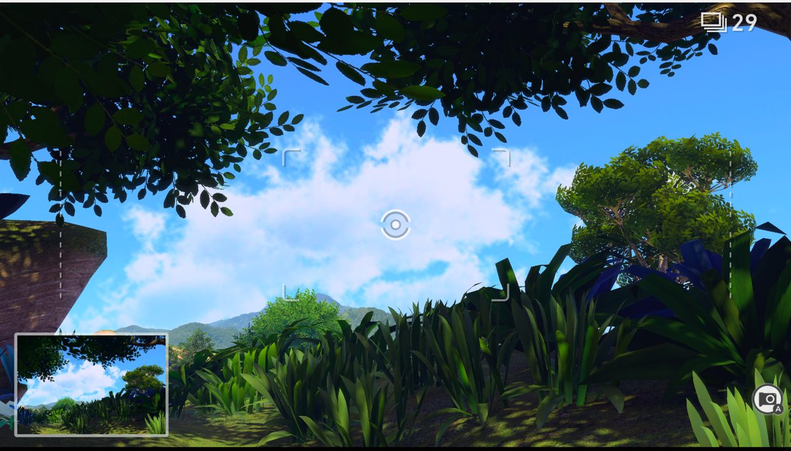
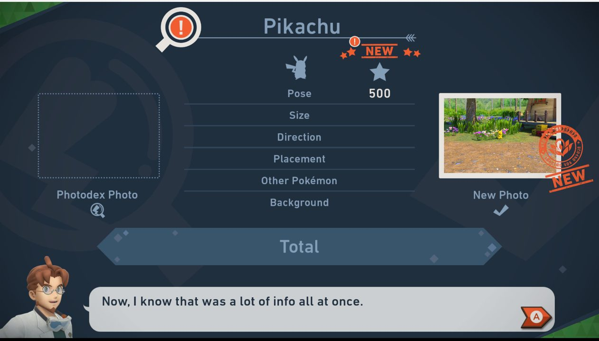
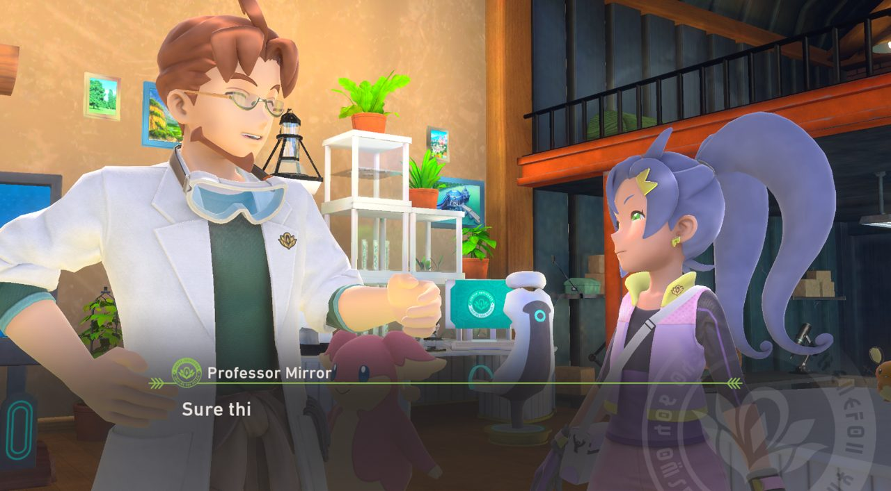

<p align="center">
  
</p>

<p align="center">
  
  
  
  
  
</p>

<p align="center">
  
</p>

**NewSnap** (NewSnapRecomp) is a native Windows recompilation of **New Pokémon Snap** (update 2.0.1). It runs the
game's own code, recompiled for PC, with a Vulkan renderer and PC options: higher resolutions, 90–144 FPS, upscalers,
frame generation and HD enhancements. It builds on [Astral Chain Recomp](https://github.com/captainj-sparrow/astral-chain-pc-recomp),
which builds on [TotK Recomp](https://github.com/valentderah/totk-pc-recomp).

**Bring your own game.** You need your own dump of the game, its 2.0.1 update and your console keys. No game data,
keys or game-derived executables are distributed here; the launcher builds the game on your PC.

## Status

| Area | State | Notes |
| --- | --- | --- |
| Tutorial, expeditions, photos, scoring, saves | Works | Played on an AMD RX 6900 XT and an NVIDIA RTX 4060 |
| Frame rate | Works | 30 / 60 / 90 / 120 / 144 FPS and a VRR mode; the interface, dialogue, input and pointer keep 60 FPS timing |
| Resolution | Works | Internal resolution 50–300 % or by display, HUD and photos intact; ultrawide (experimental) |
| Upscalers | Works | AMD FSR 3.1, FSR 4 (RX 6000/7000 through AMD's INT8 model) and NVIDIA DLSS; FSR frame generation |
| AMD RDNA 1/2 | Works | Photo, shader and GPU fault fixes specific to these GPUs |

## Features

### Picture
- Internal resolution from 50 % to 300 %, or matched to your display; real-time shadows follow it.
- AMD FSR 3.1 / FSR 4 and NVIDIA DLSS upscaling or native anti-aliasing (DLAA / Native AA), Automatic by default.
- AMD FSR frame generation, with the interface kept out of the interpolation.
- Ultrawide view (experimental): wider 3D view, interface in the middle, photos taken with the usual 16:9 view.

### Frame rate and display
- 60 FPS by default; 90, 120 and 144 FPS keep the game's own timing (dialogue, menus, pointer, controller).
- **VRR mode** (FreeSync / G-SYNC): VSync with the limit just under your monitor's refresh (138 at 144 Hz).
- Borderless window at the desktop's size by default.

### NewSnap enhancements (each one can be switched off)
- **HD photo thumbnails:** previews and photo screens show the 1080×720 photo instead of the 360×240 thumbnail.
- **HD shadows mode** (experimental): real-time shadows at their largest map and the level's light maps enlarged
  on your PC.
- **HD texture packs:** textures saved while you play and enlarged on your PC, compressed to BC1/BC3.

### Launcher
- Graphics presets with **«Recomendado»** by default, sidebar navigation, status at a glance.
- **Add to Steam** (with cover, logo and icon, for Big Picture and Steam Input) and a **desktop shortcut**.
- Imports NSP, NSZ, XCI and XCZ; updates itself and rebuilds the game locally; keeps your compiled shaders across
  updates that do not change them.

### In-game menu (Minus + Plus)
- Screen, Game, Sound, Controls, Menu, Enhancements and System tabs; English, Spanish, Russian, Brazilian
  Portuguese and Simplified Chinese.

## Screenshots

<table>
  <tr>
    <td width="50%"><br><sub>Research camp, 175 % internal resolution</sub></td>
    <td width="50%"><br><sub>Expedition, 200 % (4K inside)</sub></td>
  </tr>
  <tr>
    <td width="50%"><br><sub>Photo evaluation at 200 %</sub></td>
    <td width="50%"><br><sub>Lab at 2560 × 1440, «by display»</sub></td>
  </tr>
</table>

## Install

1. Download `NewSnapRecomp-<version>-windows-….zip` from [Releases](https://github.com/MatyMeatBoy/NewSnapRecomp/releases)
   and extract the whole folder.
2. Open `NewSnapLauncher.exe` and use **Importar NSP/XCI/NSZ…** with your base game, the 2.0.1 update and your
   `prod.keys` (or place an already imported `GameData` folder beside the launcher).
3. Press **Jugar**. The first start builds the game for your PC and prepares its shaders.

Requirements: Windows 10/11 x64, a CPU with AVX2, a Vulkan 1.3 GPU (AMD RX 6000 or newer, NVIDIA RTX, recent Intel).
Updating keeps your saves, photos, settings and compiled shaders.

## Building from source

Requires Python 3.12 and your own game files and console keys.

```powershell
git submodule update --init
py -3.12 -m venv .venv
.venv\Scripts\python -m pip install -r requirements.txt
.venv\Scripts\python -m newsnap import --base "path\base.nsp" --update "path\update.nsp" --keys "path\prod.keys" --hactool "path\hactool.exe"
.venv\Scripts\python -m newsnap launcher
.venv\Scripts\python -m unittest discover -s tests
```

Release recipe, work board and contribution rules: [docs/PENDIENTES.md](docs/PENDIENTES.md) and
[CONTRIBUTING.md](CONTRIBUTING.md). Technical notes: [SUPERSAMPLING.md](docs/SUPERSAMPLING.md),
[HIGH_FPS.md](docs/HIGH_FPS.md), [DISPLAY.md](docs/DISPLAY.md), [ULTRAWIDE.md](docs/ULTRAWIDE.md),
[UPDATING.md](docs/UPDATING.md).

## Source and content boundaries

Only original tools, adaptation patches, tests and documentation belong in this repository. NSPs, keys, ExeFS/RomFS,
generated C, compiled games, shader caches, saves and enhanced game textures stay on your PC. Do not upload your
built game.

Original additions are MIT licensed. Upstream and third-party code keep their licenses and attribution; see
[THIRD_PARTY_NOTICES.md](THIRD_PARTY_NOTICES.md). Pokémon and New Pokémon Snap are trademarks of their owners; this
project is not affiliated with Nintendo, The Pokémon Company, Game Freak or Bandai Namco.
